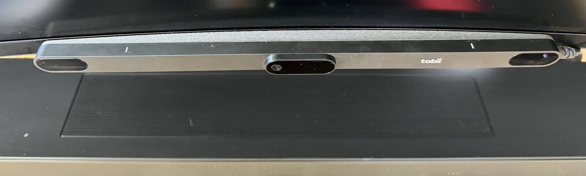

# tobii-linux


<sub>Photo: [jwanga](https://www.printables.com/@jwanga_350626), from the Printables model
[“Tobii Eye Tracker mount for curved and flat monitors”](https://www.printables.com/model/663142-tobii-eye-tracker-mount-for-curved-and-flat-monito),
[CC0 1.0](https://creativecommons.org/publicdomain/zero/1.0/), cropped.</sub>

A Linux driver stack for the **Tobii Eye Tracker 5** (USB `2104:0313`), built
by reverse-engineering the device's USB protocol. It gives you gaze, user
presence and gaze-independent 6-DOF head pose — all at 33 Hz, all at the same
time — plus calibration, through a daemon, a drop-in `libtobii.so` for Tobii's
Stream Engine 4.1 C API, and a few thin clients.

Tobii ships no Linux support for this device. Everything here was recovered
from USB captures of the Windows Stream Engine.

> Status: works daily on the author's desk. Independently reimplemented from
> USB captures; not affiliated with or endorsed by Tobii.

## What it does

| Signal | Rate | Source |
|---|---|---|
| Gaze point + validity | 33 Hz | the device's processed `0x500` stream |
| Per-eye gaze origin, eye position, user position guide, gaze data | 33 Hz | the same stream |
| Raw gaze: the Stream Engine's own record of each gaze frame | 33 Hz | the same stream, every value as sent |
| User presence | on change | the `0x504` stream |
| Head pose, 6 DOF | 33 Hz | face landmarks on the device's own IR frames |
| IR camera image, 280×280 | 33 Hz | the `0x50e` stream |
| The Stream Engine's custom stream 0 (no data on the ET5) | ~133 Hz as the ET5 sends it, while subscribed | the `0x1770` stream, which the daemon starts for its subscribers |
| Device info, track box, display area, the stream catalogue and each stream's columns | on request | the device's own answers |
| Notifications: display area, calibration, pause, faults, warnings | on change | the device's own, and the daemon's for calibration and pause |
| Calibration | on demand | `tobii-calibrate`, saved per user |

Everything the Stream Engine reports from the tracker's data is reproduced
bit for bit: replaying a captured Windows session through the decoder gives
exactly the gaze points and gaze origins the Stream Engine delivered for it
(5 284 of 5 284 frames, error 0; `tobii5-init-replay compare-dll`). The head
pose is computed, not decoded, on Windows too: libtobii's position follows the
Stream Engine's to a median of a few millimetres, while its yaw and pitch, by
design, follow the head's true turn, which the Stream Engine under-reads: yaw
turns 1.3 to 1.4 times as far as the Stream Engine's and pitch 0.7 to 0.9
times as far (Architecture, *Head pose*).

Against a laser fixed to the head (one person, three sessions, Tobii's
runtime 4.72 in a Windows 11 virtual machine), libtobii's yaw moves 0.99 to
1.01 times as far as the head turned and the Stream Engine's 0.72 to 0.79,
mostly through a gain fitted to that measurement; without the gain,
libtobii's scale also held steadier from one session to the next. That is
where it measured better. The Stream Engine's pose is quieter at rest
(libtobii's yaw is up to 1.8 times as noisy), comes out sooner after each
image (about 2 ms on Windows, about 11 ms here, measured separately) and
keeps the face at large turns a little more often (Architecture, *Head
pose*; `tools/headpose/README.md`, "Laser truth").

The head pose is **gaze-independent**: turning your eyes does not move it.

### The interesting part

The device multiplexes a second stream, `0x50e` `primary_camera_image`, on the
same bulk endpoint as gaze — a 280×280 8-bit IR frame of your face at 33 Hz.
The Windows driver subscribes to it with command 1220 right after init; nothing
in the documented API hints it exists. It is what the Stream Engine's head pose
is made of: no head pose crosses the USB, and Tobii's runtime computes one on
the host from every frame.

That matters because the eye-position fields in the gaze stream **cannot** give
you a signed head yaw. Both eyes are reconstructed at equal range from the
camera, so the per-eye depth is synthetic and any "yaw" computed from it is
lateral head position in disguise. Feeding the IR frames to a face-landmark
model instead gives a real signed yaw at ~2° resolution, and it costs about
6 ms of CPU per frame. That conclusion came out of a field-by-field study of
11 800 recorded frames, cross-checked against head poses read off the IR images
themselves; the tooling for it is in `tobii-tools`.

## Quick start

Each [release](https://github.com/Skyggedans/tobii-linux/releases) carries
ready-made packages for x86_64: a `.deb` (Debian 12, Ubuntu 22.04 and newer),
an `.rpm` (Fedora, openSUSE) and a tar.gz with an `install.sh` for any other
distribution with systemd and glibc 2.35 or newer (INSTALL.md §0). They install the
daemon, `libtobii.so` and its headers, the clients, the udev rules and the
user units, and put "Tobii Calibration" among the desktop's applications.

From source:

```bash
cargo build --release --workspace     # or: make build
make install                          # binaries + libtobii.so + headers + udev rules + desktop entry + user units
make enable                           # start the daemon now
tobii-calibrate                       # calibrate for your eyes (once)
```

Then either link against `libtobii.so`, or run a client:

```bash
tobii-opentrack                       # head pose -> OpenTrack UDP 127.0.0.1:4242
tobii-gaze-keys                       # screen edge + hold Super -> arrow keys; double wink -> Super+arrow
```

`tobii-gaze-keys` needs the `input` group (`sudo usermod -aG input "$USER"`,
then a reboot), which lets every program you run read all keyboards:
INSTALL.md §3 weighs it. `tobii-opentrack` sends the Stream Engine's head
pose, the one `libtobii.so` delivers, each axis as OpenTrack's own
`tracker-tobii` plugin hands it over, so one OpenTrack profile fits either;
OpenTrack centres it, at the first pose and on its *Center* shortcut. Both
clients also come as user services: `systemctl --user start tobii-opentrack`
while you play (`enable --now` for every login), and
`tobii-gaze-keys.service` likewise.

`libtobii.so` is API-compatible with Tobii's Stream Engine 4.1: it exports
the same 153 functions as `tobii_stream_engine.dll` 4.1.0.3, with the DLL's
signatures (`tools/abi/dll_abi.py headers` checks every prototype), error
codes, enum values and struct layouts (the size of `tobii_stream_type_t` is
inferred, and what the fields of `tobii_hardware_configuration_t` hold is
provisional, as the headers say), so a program written for Stream Engine
4.1 builds against its headers and runs unchanged; Architecture says what
each function does with an ET5. OpenTrack's own Tobii tracker, the
`tracker-tobii` plugin, is one once it is brought to Stream Engine 4: built
on Linux from the `tracker-tobii-linux` branch of the
[OpenTrack fork](https://github.com/Skyggedans/opentrack/tree/tracker-tobii-linux),
it reads the head pose through libtobii, with no UDP bridge. The fork lets
the plugin build on Linux and against Stream Engine 4, reconnect after a
daemon restart and hold its last pose while the face is lost (INSTALL.md
§8).

Full instructions, tuning knobs and troubleshooting are in
**[INSTALL.md](INSTALL.md)**.

Requirements: a stable Rust toolchain, libusb, and the tracker plugged in. The
face models and the init capture are embedded at build time, so the installed
binaries need no runtime data files.

## Architecture

```
libtobii.so ─────┐
tobii-opentrack ─┤
tobii-gaze-keys ─┼── unix socket ──► tobiid ──USB──► Tobii ET5
tobii-calibrate ─┘                      │
                              EP 0x83: gaze 0x500, presence 0x504, IR image 0x50e,
                                       custom stream 0x1770 while a client holds it
```

`tobiid` is the only process that claims the device; everyone else is a client,
so several consumers can read gaze and head pose at once.

`libtobii.so` exports **all 153 entry points** of Tobii's
`tobii_stream_engine.dll` 4.1.0.3, and no others, with its signatures, error
numbering and struct layouts — so any Stream Engine client links and runs. The
ABI was recovered from the DLL itself (`tools/abi/`) and the archived 4.1.0
reference. What stands behind the entry points:

| | Entry points |
|---|---|
| Implemented (daemon-backed) | device lifetime and callbacks; gaze point, gaze origin, eye position, user position guide, presence, head pose, gaze data, raw gaze (the Stream Engine's own record of each gaze frame, `tobii_gaze_raw_subscribe`), the foveated rendering gaze point (made from raw gaze as the Stream Engine makes it for a tracker it drives itself, `tobii_foveated_rendering_gaze_point_subscribe`) and IR image streams; the custom stream (the tracker's stream 0x1770 as custom stream 0, subscribed by the Stream Engine's rules, `tobii_custom_stream_subscribe`; its frames carry no data on the ET5); image collection's subscribe (the tracker's stream 0x508, started as the Stream Engine starts it, `tobii_image_collection_subscribe`; the ET5 refuses it, so it answers `TOBII_ERROR_INTERNAL`, as the Stream Engine does, and no frame is ever delivered); notifications (display area, calibration state and id, pause, power save, faults and warnings); device info (the public and the internal one, `tobii_get_device_info_internal`), track box, display area (get/set), mounting, states; 2-D calibration, including discarding a point; the device/host clock pair (`tobii_timesync`); the tracker's stream catalogue and its streams' columns (`tobii_enumerate_stream_type_columns`); internal-stream support (the IR image, and the custom stream and image collection while that catalogue lists them, as the Stream Engine answers for an ET5, `tobii_internal_stream_supported`); device pause and resume; power save, entered and left (`tobii_power_save_activate`, `_deactivate`), with its state and remote wake's; the tracker's extension lists (`tobii_enumerate_extensions`, `_enabled_extensions`), which on an ET5 are empty; the device name (kept by the host); the hardware configuration (provisional, see below) |
| Answered locally | API version, error texts (the DLL's), system clock, output frequency (33 Hz), enabled eye, capabilities, feature group, license validation, display-area calculation, calibration parsing, internal-capability support (eyeball centres only), lens-configuration writability (never), usage statistics (`TOBII_ERROR_NOT_AVAILABLE`, as the DLL answers without Tobii's Stream Engine Services); setting the illumination mode and enabling an extension (`TOBII_ERROR_INSUFFICIENT_LICENSE`, as the DLL answers a consumer ET5 without asking the tracker) |
| `TOBII_ERROR_NOT_SUPPORTED` | what the ET5 refuses: remote wake and reading the illumination mode, whose commands it answers with an error the Stream Engine turns into this very code (the state commands, below); the configuration key, which it refuses until a realm it names (10000) is open (the Stream Engine answers otherwise, see the licences below); and what it was never observed doing: wearable, face id, firmware, diagnostics, custom commands, licence storage on the device, 3-D and per-eye calibration, calibration stimulus points, the internal low-frequency head rotation and position, multiple faces position, wearable limited image and secondary camera image streams (for the wearable entry points, the digital sync port, face id, 3-D and per-eye calibration, the stimulus points and those five streams, the DLL's own answer for a tracker it drives itself through its in-process legacy TTP module, once the arguments check out; behind Tobii's service, never captured; per-eye calibration only inside the handle's own session, `TOBII_ERROR_CALIBRATION_NOT_STARTED` outside it, as there; for the face types, which the DLL asks the tracker for, and licence storage, which it offers a tracker with persistent storage, inferred) |

Where the answers come from, and where they differ from Windows:

- **No licences.** Every key validates and the feature group is consumer, but
  nothing checks it: gaze data, timesync, calibration, display-area and name
  writes, the IR image, raw gaze, the internal device info, the stream
  catalogue, its streams' columns and pause all work, though the Stream
  Engine reserves them for higher feature groups (raw gaze, the internal
  device info, the stream catalogue, its columns and, in its own service,
  pause for its internal one)
  or, for the IR image, an additional-features licence. Where the Stream
  Engine refuses a consumer with `TOBII_ERROR_INSUFFICIENT_LICENSE` what the
  ET5 cannot do anyway (per-eye calibration inside a session, setting the
  face type), `libtobii.so` answers what it would past that check,
  `TOBII_ERROR_NOT_SUPPORTED`. The state commands split the difference, by
  choice: the extension lists answer past the check (they ask the tracker,
  where the Stream Engine refuses a consumer ET5), while setting the
  illumination mode and enabling an extension keep its refusal,
  `TOBII_ERROR_INSUFFICIENT_LICENSE`. Nothing could switch an extension off
  again, and the ET5 refuses to report an illumination mode and has no
  extension to enable. The configuration key is neither: it stays
  `TOBII_ERROR_NOT_SUPPORTED`, where the Stream Engine refuses a consumer
  `TOBII_ERROR_INSUFFICIENT_LICENSE` and, past that check, would report the
  ET5's refusal (it wants realm 10000 open) as
  `TOBII_ERROR_CONNECTION_FAILED`.
- **Facts from the last init.** Device info (both), track box, display area,
  mounting, the stream catalogue and its streams' columns, the hardware
  configuration and the fault and warning lists (`tobii_get_state_string`)
  are what the tracker reported at its last init, so they are answered even
  while it is unplugged
  (`TOBII_ERROR_TIMED_OUT` only if the daemon has not seen a tracker yet). A
  fault or warning list the tracker announces later (3200/3210, a layout
  taken from the Stream Engine and never yet seen from an ET5) replaces the
  one its init reported, and reaches notification subscribers either way, as
  in the Stream Engine. The first call that needs the tracker starts it, and
  it then stays on (IR illuminator lit) for as long as that connection is
  open, as for an open device in the Stream Engine. While it is unplugged,
  such a call (a clock pair, a pause, starting, retrieving or applying a
  calibration, a display-area write) is `TOBII_ERROR_CONNECTION_FAILED` at
  once from when the daemon has given the tracker up, a few seconds after
  the unplug (until then the call waits on the daemon's re-opens), and the
  daemon starts the tracker once it is plugged back in, for a connection
  still open. The subscribe of custom stream 0 or of image collection
  answers so too while the daemon holds the stream for no connection; one
  that waits on the re-opens gets what the Stream Engine answers for a
  tracker lost under the stream's start,
  `TOBII_ERROR_CONNECTION_FAILED_DRIVER` for the custom stream and
  `TOBII_ERROR_NO_ERROR` for image collection. A subscribe of a stream the
  daemon holds already (another connection subscribed it, say) joins it
  instead, `TOBII_ERROR_NO_ERROR` at once with or without the tracker, and
  the custom stream's frames come once the tracker is back.
  A calibration session its owner is not already stopping ends, saving
  nothing, when the daemon loses the tracker or the tracker re-initialises:
  its owner's later calls in it, `tobii_calibration_stop` included, are
  `TOBII_ERROR_CALIBRATION_NOT_STARTED`. A stop under way finishes, and a
  calibration it has saved stays saved even if the stop then fails
  (`TOBII_ERROR_CONNECTION_FAILED` when the tracker went away); the tracker
  loads it at its next init. Such a stop logs an ERROR line saying the
  calibration was saved but may not have been applied, since its status
  alone reads as a stop that kept nothing, and `tobii-calibrate` says so and
  exits 2.
- **Waiting for the daemon.** A call that asks the daemon (any but a
  subscription change or a reconnect, which wait 2 s and ~500 ms for their
  acknowledgement; the subscribes and unsubscribes of the custom stream and
  image collection ask it) waits for the answer longer than the daemon's own
  deadlines let it take, so `TOBII_ERROR_TIMED_OUT` is the daemon's answer
  (or a daemon held up past them), not libtobii giving up on a call the
  daemon then carries out (a calibration started, a display area set).
  Within the daemon's deadlines that happens only behind a stop of the
  custom stream or image collection that libtobii sends without waiting for
  it, when the daemon refused an unsubscribe's stop (another client's start
  or stop of either stream kept it waiting 20 s) or libtobii gave up on a
  subscribe's start: the daemon runs that stop before the device's next
  call, for up to ~53 s, and a call whose own wait runs out meanwhile (a
  state read waits ~3 s) is `TOBII_ERROR_TIMED_OUT`, yet carried out. A
  call answered from the facts waits at most ~12 s, for the tracker's first
  init. One that needs the tracker live waits for it to stream (~12 s from
  cold) and answer, and at worst for the daemon's own deadlines: 30 s for
  the tracker to take each command, plus the command's, which comes to 35 s
  for `tobii_calibration_retrieve`, about a minute for a subscribe or
  unsubscribe of the custom stream or image collection (which may also wait
  20 s for another start or stop of either stream) and about 3 min for a
  `tobii_calibration_start` that fails and puts the calibration back
  (`crates/tobii-ipc/src/timeout.rs` has every request's timeout, which
  `tobii-calibrate` and `ipc-probe` wait too, and
  `crates/tobii-ffi/src/timeouts.rs` which call waits which).
- **Lost daemon.** When the connection to `tobiid` is lost (the daemon
  stopped, crashed or was restarted), `tobii_device_process_callbacks`
  delivers what had arrived and then returns `TOBII_ERROR_CONNECTION_FAILED`
  on every call; the DLL returns it without delivering its queue on that
  call. `tobii_wait_for_callbacks` wakes once for the loss and never returns
  `TOBII_ERROR_CONNECTION_FAILED`. Nothing reconnects by itself: as the
  Stream Engine documentation says, the application calls
  `tobii_device_reconnect`. That only connects to a running daemon (it never
  spawns one, unlike `tobii_device_create`), gives up with
  `TOBII_ERROR_CONNECTION_FAILED` within ~500 ms when it cannot, and
  restores the subscriptions and the holds of the custom stream and image
  collection (the daemon starts the streams again itself; a daemon that
  refuses a hold fails the reconnect, a tracker that refuses a start does
  not, where it fails the Stream Engine's), not a calibration session or a
  pause the lost connection held.
  Reconnecting a live connection drops the samples the old one brought that
  were not delivered yet, which may lose those tobiid sent it alone just
  before (from the new one's first tick on it sends both the same, and each
  is delivered once), but keeps its notifications, which tobiid sends once
  and does not repeat to a new connection: they come ahead of the new
  connection's, and one sent to both may be delivered again, after later
  ones, so a state may be seen to step back before it settles (the last
  delivered is current). A tracker unplug is not a lost connection and never
  shows in `tobii_device_process_callbacks`: the daemon keeps every
  connection, and the samples resume on it once the tracker is back. Requests
  that need the tracker get `TOBII_ERROR_CONNECTION_FAILED` meanwhile
  (above), but that is the daemon's answer over a live connection, and a
  reconnect then succeeds without bringing the tracker back. OpenTrack's
  `tracker-tobii` plugin needs a reconnect call to recover by itself; as it
  stands, stopping and starting tracking recovers it (INSTALL.md §8).
- **Pause.** One state for the tracker, shared by every client, as in the
  Stream Engine: the last call wins and any client may resume.
  `TOBII_STATE_DEVICE_PAUSED` and a `DEVICE_PAUSED_STATE_CHANGED`
  notification change as soon as the tracker accepts the call. A pause ends
  when the client that paused last disconnects, and when the tracker
  re-initialises (after a USB failure or an unplug). A resume the tracker
  does not answer still succeeds: the daemon re-opens the silent tracker, and
  its init resumes it. Pausing during a calibration session is
  `TOBII_ERROR_CALIBRATION_BUSY`; starting one, or asking for
  `tobii_timesync`, while paused is `TOBII_ERROR_NOT_AVAILABLE`.
- **Power save.** `tobii_power_save_activate` and `_deactivate` send the
  tracker the Stream Engine's own commands, which the ET5 carries out; power
  save does not stop the sensor, and gaze keeps coming. It is one state for
  the tracker, as the pause is: the last call wins, any client may end it,
  and the daemon ends it when the client whose call is in effect (the last
  to enter it) disconnects, which the Stream Engine, living in its client's
  process, never has to do. The ET5 keeps power save through a re-open, the
  device's teardown and a new init included; the daemon sends nothing at a
  re-initialisation, unlike for a pause, and never re-applies power save.
  Nor does it end power save when it stops: a daemon stopped or restarted
  while a client holds it leaves the tracker in power save, with nobody
  holding it, as the Stream Engine leaves it when its process ends, until a
  client ends it. Ending it for a client that went away, it records power
  save off from the tracker's answer, since an engine stopping for want of
  clients may never read the notification that follows.
  `TOBII_STATE_POWER_SAVE_ACTIVE` follows the tracker's own notifications
  rather than the call, as in the Stream Engine, and the ET5 sends one for
  each change. Remote wake the ET5 does not implement:
  `TOBII_STATE_REMOTE_WAKE_ACTIVE` reads false from the tracker's status,
  and arming or disarming it is `TOBII_ERROR_NOT_SUPPORTED`, which is how
  the Stream Engine reports the tracker's refusal.
- **Notifications.** Seven of the thirteen types are delivered:
  `CALIBRATION_STATE_CHANGED` and `DEVICE_PAUSED_STATE_CHANGED` from the
  daemon itself, when a calibration session starts or ends and when the
  tracker accepts a pause or resume (the Stream Engine waits for the
  tracker's own messages, of which the ET5 was seen sending only the
  pause's); `DISPLAY_AREA_CHANGED`, `CALIBRATION_ID_CHANGED`,
  `FAULTS_CHANGED` and `WARNINGS_CHANGED` from the tracker's, one for each
  (as the Stream Engine does for faults and warnings, and as far as traced
  for the other two); `POWER_SAVE_STATE_CHANGED` from the tracker's too,
  every one, as the Stream Engine passes them on, and none on subscribe,
  where the Stream Engine may hand out an initial "off" (not traced).
  The others never come: the output frequency is
  fixed at 33 Hz, both eyes are always used, the ET5 was never seen changing
  its track box or reporting a face type, and the
  Stream Engine has no source for `CALIBRATION_ENABLED_EYE_CHANGED`.
  Exclusive mode is not reported either: the ET5 sends what the Stream
  Engine reads as exclusive mode on and off only on Linux, whenever an open
  starts the sensor (a cold engine start, or a re-open after the stream
  was lost): on with that open, off with the re-open that primes the
  stream about 10 s later. It never does so on Windows, so it says nothing
  about another application; `TOBII_STATE_EXCLUSIVE_MODE` stays false. The
  Stream Engine most likely also delivers one
  `COMBINED_GAZE_EYE_SELECTION_CHANGED` (both eyes) after
  `tobii_device_create` or `tobii_device_reconnect`, from the tracker's
  answer to its init; libtobii does not. `tools/abi/README.md` has the
  Stream Engine's side.
- **Device name.** A name set with `tobii_set_device_name` is kept by the
  daemon in `~/.config/tobii/device-name`, for every client and later
  sessions; nothing is written to the tracker. Until one is set,
  `tobii_get_device_name` gives the model.
- **Calibration parsing.** `tobii_calibration_parse` checks the whole blob
  before it hands out a point: data that is not a valid calibration is
  `TOBII_ERROR_OPERATION_FAILED`, as the Stream Engine documentation says.
  That is a blob shorter than its 44-byte header or over 4 MiB, a point list
  that lies outside the blob, holds more than 256 points or does not end
  exactly at `data_size`, a status word other than -1, 0, 1 or 2 (its low
  32 bits read as a signed int, as the Stream Engine reads them, with the
  upper 32 zero, or all ones with -1), and a value that is not finite or
  lies more than half a display off it, but for the mapping of an eye
  marked failed (-1). The Stream Engine returns that only for a negative
  point count; it reads everything else as given, past `data_size` if the
  blob says so, and returns `TOBII_ERROR_NO_ERROR` (8 zero bytes are an
  empty calibration there). Both report an eye whose status word is -1 as
  `FAILED_OR_INVALID` and pass its mapping on as the blob holds it.
- **Head pose.** The Stream Engine's comes from Tobii's runtime, which computes
  it on the host from each IR image; libtobii's from the daemon, which runs a
  face-landmark tracker on the same images and a model fitted to the poses the
  DLL delivered in three captured Windows sessions. It has the Stream Engine's
  form: absolute, in the display frame of the display area in effect, as gaze
  origins are (the position a point between the eyes, in mm from the area's
  centre; the rotation as the Stream Engine's yxz Euler angles, zero for a face
  square to the display), unclamped; one pose for every IR image, ~33 Hz, with
  the image's time; and invalid, all four validities at
  once, when there is no face or it is at the edge of the image, where the
  Stream Engine's turns invalid too. An invalid pose holds the last valid
  values (zeros before the first), where the DLL's holds leftovers of its other
  callbacks. Replayed through the daemon's pipeline without its rotation gains
  (the model fitted to the Stream Engine's pose, which `tobii5-init-replay
  compare-dll --head` replays), the three sessions' poses are valid on 96.8 to
  100 % of the images on which the DLL's are, and differ from the DLL's by a
  median 2.2 to 4.0° in rotation, 4 to 7 mm in z and under 4 mm across;
  constants fitted on two of the sessions do about as well on the third
  (`tools/headpose/README.md`). Those are medians over every image, most of
  them near straight ahead, not bounds, and they hide a scale: TX, TZ and roll
  move as far as the DLL's to within 3 %, TY 0.84 to 0.96 times as far; yaw
  and pitch, by design, do not. Measured with a laser pointer fixed to the head
  and aimed at rings on the screen, the Stream Engine under-reads a turn, and
  by a factor that changes from one session to the next (yaw 0.72 to 0.79 of
  the true angle, pitch 0.76 to 0.95, in three recorded sessions), where the
  model fitted to it read yaw a steady 0.80 and pitch 1.07 to 1.11. libtobii
  scales its yaw and pitch to the true angles (`HeadParams::rotation_gain`,
  1.249 and 0.913; with gains fitted without a session, 0.99 to 1.01 of the
  truth in yaw and 0.96 to 1.02 in pitch on it), so its yaw turns 1.27 to 1.44
  times as far as the Stream Engine's and its pitch 0.72 to 0.90 times as far
  in the Windows sessions, and its rotation differs from the DLL's by a median
  2.9 to 6.1° (8 to 11° where the DLL's yaw is 20° or more). Small yaw turns
  read short, as the Stream Engine's do more: about 0.8 of a 5° turn and 0.93
  of a 10° one, whole at 20 to 25° (INSTALL.md §8 has every axis;
  `tools/headpose/README.md`, "Laser truth", the measurement, of one person at
  one screen). What it does not reproduce: the head size the runtime ranges by,
  which differed by up to 1.5 % between the sessions (6 to 9 mm in z at a
  desk), where the model has one constant; the range the runtime reports 7.5 to
  11 % long for some 17 images after it finds a lost face again; its filters,
  which an EMA on the position and one-euro filters of one shared setting (1.0
  Hz, 0.2) on the three angles approximate (lags that differ from the DLL's by
  up to 13 ms on the angles and 21 ms on the position, noise at rest 0.6 to 1.4
  times the DLL's without the gains, which scale it too: yaw's up to 1.8 times
  the DLL's); and a pose for every image: the daemon's pose worker takes
  the newest image, and one it has not taken by the time the next comes gets
  none, which at ~6 ms an image on a desktop CPU, against 30 ms between images,
  takes a busy machine (`TOBII_IMAGE83_DEBUG` counts them, INSTALL.md §7).
  As with the Stream Engine, an application centres the pose itself, as
  OpenTrack does.
- **Timestamps.** Every callback timestamp but the tracker times below is on
  `tobii_system_clock`'s clock, as in the Stream Engine; the tracker's clock
  is left only in gaze data's and raw gaze's `timestamp_tracker_us` (raw
  gaze has no other time) and `tobii_timesync`'s `tracker_us`. The foveated
  rendering gaze point, which the Stream Engine stamps with raw gaze's
  tracker time plus its offset, takes the host time `tobiid` sends beside
  each raw gaze frame (a `tobiid` from before that sends none, and it then
  carries the tracker's). A head
  pose carries the time of the IR image it was made from, as there. The
  Stream Engine adds one offset per connection, from round trips to its
  service, and refreshes it only in `tobii_update_timesync` and
  `tobii_timesync`. Here the daemon's USB engine estimates the offset from
  the arrivals: the smallest receipt-minus-device time of the gaze frames and
  IR images of the last 120 s (the gaze frames alone when the image stream is
  off), started afresh at every tracker init, which may restart the
  tracker's clock. So it follows the drift between the clocks (5 to 13 ppm
  in the captures, some 50 ms an hour for a fixed offset), and every client
  gets the same stamps. The interval between two stamps can then differ
  from the tracker's by a couple of ms when the estimate moves (the Stream
  Engine's are exact within a connection), though never below 1 µs within a
  stream while the tracker stays open; across an init the stamps run on with
  the host clock instead of jumping back, and a presence reported again to a
  new subscriber keeps the stamp it was last reported with. A stamp is no
  later than the daemon's read of its sample (1 µs past it when two samples
  of a stream are read together), but for a sample read during the
  tracker's init, which gets the time it is delivered, a few ms late.
- **Clock pair.** `tobii_timesync` pairs the device timestamp of the next gaze
  frame with the host clock (`CLOCK_MONOTONIC`, as `tobii_system_clock`) in a
  fixed 30 ms bracket; the Stream Engine times a round trip instead, on
  `QueryPerformanceCounter`. With no tracker plugged in it is
  `TOBII_ERROR_CONNECTION_FAILED` rather than a wait, and a tracker unplugged
  shortly before or during the call makes it so about a second after the
  daemon gives the tracker up.
- **Hardware configuration.** Its layout is the DLL's, but what the fields
  hold is inferred from one Windows capture, and on Linux the ET5 has
  answered its command (2120) with no data, so
  `tobii_hardware_configuration_get` is `TOBII_ERROR_NOT_SUPPORTED` until it
  reports one.
- **Threads.** As the Stream Engine promises, the functions may be called
  from several threads at once, on one device too: a device's state is
  locked by concern, as the DLL's is. Its requests, subscription changes and
  reconnects run one at a time, in the order they are called, each for its
  whole round trip to tobiid (a calibration start may take ~3 min at worst,
  a pause a minute: *Waiting for the daemon*), so one thread's calls made
  back to back hold another thread's up for one of them at most. They do not
  hold up its callbacks, processing or waiting, but for a reconnect's round
  trip (~500 ms at most) and its close of the old connection; a reconnect's
  ~500 ms counts from when the calls ahead of it, and then a process call
  another thread is making, have finished. Its callbacks run one at a time,
  on whichever thread processes it, and a subscribe, an unsubscribe, a clear
  or a reconnect waits for one running on another thread; once an
  unsubscribe returns, its callback is not running and never runs again.
  `tobii_device_destroy` and `tobii_api_destroy` take no lock, as in the
  Stream Engine (whose documentation says so for `tobii_device_destroy`): no
  other thread may be inside a call on the handle, or use it afterwards.
  Threads that create devices at once while no daemon runs spawn one
  `tobiid` between them: the others wait for that spawn, then connect to its
  daemon or fail as it did (two processes doing so can still spawn one
  each). `TOBII_ERROR_CALLBACK_IN_PROGRESS` guards only the thread a
  callback, the logger or `tobii_calibration_retrieve`'s receiver runs on. A
  callback, or the logger, must not block on another thread's call into any
  device (nor on a thread that waits for one), which can deadlock, as in the
  Stream Engine: only processing and waiting are sure to go on while a
  callback runs. The retrieve receiver holds no lock, so it may wait for
  other threads' calls. Unlike the DLL, a device's requests, subscription
  changes and reconnects run in the order they are called, where the DLL's
  critical section promises no order among its waiters (Windows semantics,
  not read from the DLL), so there one thread's calls made back to back may
  keep another thread's out for long; `tobii_wait_for_callbacks` waits on a
  device another thread is processing as on any other, where the DLL skips
  such a device, returning at once when it was the only one, so a
  wait-and-process loop on that device alone spins; a subscribe lets the
  device's other callbacks run during its round trip, where the DLL's, but
  for its custom stream subscribe, holds them back, and it sets its own
  first, where the DLL stores it once the round trip is done, so a
  subscribe that fails may have had its callback called before it
  returned; a `tobii_device_process_callbacks` that finds another
  thread processing returns at once, as there, but with
  `TOBII_ERROR_CONNECTION_FAILED` once the loss has been reported, and
  delivers nothing (the DLL first delivers the device's queued
  notifications); a clear waits for another thread's processing, never for a
  request (both wait for a reconnect's round trip and its close of the old
  connection);
  `tobii_calibration_retrieve` calls its receiver with no lock held, where
  the DLL holds the device's API mutex; and the logger is never called under
  a lock of the call that logs.
- **Logging and allocation.** The `tobii_custom_log_t` logger gets
  libtobii's own few lines (a refused `field_of_use`, a failed connect or
  reconnect, a lost daemon connection once per loss, a daemon reply that
  does not decode, a calibration stop that failed after the daemon saved the
  calibration, a head pose the daemon has not sent in the 20 s since it was
  subscribed and a custom stream or image collection it refuses as not
  supported though the tracker lists it, each once per device, each connect
  and reconnect), not the line per failing call the Stream Engine writes:
  the returned status says that. It is called on the thread inside the call
  that logs, from several threads at once if they log at once (their lines
  may interleave), and a device keeps logging through it after
  `tobii_api_destroy`. A `tobii_custom_alloc_t` is checked as in the Stream
  Engine and never called: libtobii allocates with Rust's allocator, where
  the DLL allocates the API handle, each device and long log lines through
  it (INSTALL.md §8).

The headers are in `crates/tobii-ffi/include/tobii/` (installed to
`/usr/include/tobii/` by the packages, `/usr/local/include/tobii/` by `make
install` and the tarball); OpenTrack's `tracker-tobii` plugin builds against
them from the `tracker-tobii-linux` branch of the
[OpenTrack fork](https://github.com/Skyggedans/opentrack/tree/tracker-tobii-linux),
which brings it to Stream Engine 4 and lets it configure on Linux
(INSTALL.md §8).

### Workspace

Eleven crates, split so the driver never compiles the research tooling and
`libtobii.so` links neither ONNX Runtime nor the embedded assets (it is 0.45 MB
rather than 20 MB).

| Crate | Holds | Heavy deps |
|---|---|---|
| `tobii-proto` | wire formats: framing, TLV, commands, the gaze/presence/image/custom streams, device facts, the capture log | none |
| `tobii-pose` | face landmarks, face detection and the Stream Engine's head pose; owns the models | `ort` |
| `tobii-usb` | USB transport and the live `0x83` engine; owns the init capture | `rusb` |
| `tobii-ipc` | the daemon protocol and its deadlines, the display geometry and the host clock | none (`libc` only) |
| `tobii-calib` | the calibration blob format and the per-user store | none (std only) |
| `tobii-log` | shared `tracing` setup | — |
| `tobiid` | the daemon | — |
| `tobii-ffi` | `libtobii.so` (cdylib) | — |
| `tobii-clients` | `tobii-opentrack`, `tobii-gaze-keys` | — |
| `tobii-calibrate` | the calibration window | `winit`, `softbuffer` |
| `tobii-tools` | `tobii5-init-replay`: log analysis, UVC camera, diagnostics | all of the above |

`make check` runs fmt, clippy with `-D warnings`, the tests and rustdoc.
`make verify-abi` asserts `libtobii.so` exports exactly the 153 symbols in
`crates/tobii-ffi/abi-symbols.txt`, then compiles and runs
`crates/tobii-ffi/abi-smoke.c` against the headers: it takes the address of
every symbol through them and checks versions, rejections and struct layouts.

## Research tooling

`tobii5-init-replay` is built but not installed — none of it is needed to run
the driver. It is the bench the protocol was worked out on, and it is still the
regression harness:

```bash
target/release/tobii5-init-replay image83 --secs 10 --pose   # live A/B of both streams
target/release/tobii5-init-replay probe                      # 0x83 vs UVC concurrency
target/release/tobii5-init-replay image83-replay log.bin --csv out.csv
target/release/tobii5-init-replay analyze-log log.bin        # blind field scan
target/release/tobii5-init-replay head-axes yaw:a.bin roll:b.bin
target/release/tobii5-init-replay compare-dll session.bin session.jsonl  # decoder vs the DLL
target/release/tobii5-init-replay ipc-probe --secs 5         # ask the running daemon everything
target/release/tobii5-init-replay stream-probe 0x501 --log p.bin  # start one catalogue stream, log it (tobiid stopped)
tools/abi/dll_abi.py headers                                 # headers vs tobii_stream_engine.dll
tools/headpose/fit.py --session LOG JSONL FITS ...           # refit the head pose constants
tools/headpose/evaluate.py --session LOG JSONL FITS ...      # head pose (no gains) vs the DLL's
tools/headpose/truth.py --session LOG JSONL FITS ...         # yaw and pitch vs laser-measured turns
```

`tools/headpose/README.md` has the head pose's refit and acceptance procedure.

## Extras

- **[gaze-switcher/](gaze-switcher/)** — a GNOME Shell extension that lets you
  pick a window in the Alt+Tab switcher by looking at it.
- **[tools/splice_calibration.py](tools/splice_calibration.py)** — injects a
  calibration blob into a captured init sequence (superseded by
  `tobii-calibrate`, kept for research).

## Limitations

- One process owns the device. `tobiid` arbitrates; run everything else as a
  client.
- The UVC camera interface and the `0x83` streams are mutually exclusive in
  firmware. Nothing in the driver uses UVC any more, but keep the shipped
  `99-tobii-no-uvcvideo.rules` in place so nothing else grabs it.
- Head pose needs a face in frame. Without one, or with one at the edge of
  the frame, `libtobii.so` marks its head pose invalid, as the Stream Engine
  does; `tobii-opentrack` then sends nothing, and OpenTrack holds the last
  pose.
- Until you run `tobii-calibrate`, the calibration in use is the one embedded
  in `init_packets_ep.txt` — the author's. Likewise the display area is the
  author's 27" monitor until you set yours: `tobii-calibrate` does it first
  (you line two ticks up with the marks on the tracker), and the daemon keeps
  whatever display area is set (`~/.config/tobii/display-area`).
- The calibration sequence mirrors the one captured from Windows; 3-D and
  per-eye calibration are not supported, as the Stream Engine answers for
  an ET5 (per-eye calls are `TOBII_ERROR_CALIBRATION_NOT_STARTED` outside the
  handle's own session, as there). Discarding a
  2-D point and pausing the tracker send the commands the DLL sends for them
  (1080, and 3100 with 1), which were never captured.

## License

MIT ([LICENSE](LICENSE)), except for the MediaPipe material that `tobii-pose`
embeds, and that `tobiid` and `tobii5-init-replay` carry with it: the
face-landmark and face-detection models
(`crates/tobii-pose/models/face_landmarks.onnx` and
`blaze_face_short_range.onnx`, converted from TensorFlow Lite to ONNX) and the
canonical face mesh in `crates/tobii-pose/src/canonical.rs`. Those are
Apache-2.0. The licence text, the notice and where they come from are in
[crates/tobii-pose/models/](crates/tobii-pose/models/) (`LICENSE`, `NOTICE`,
`README.md`).
